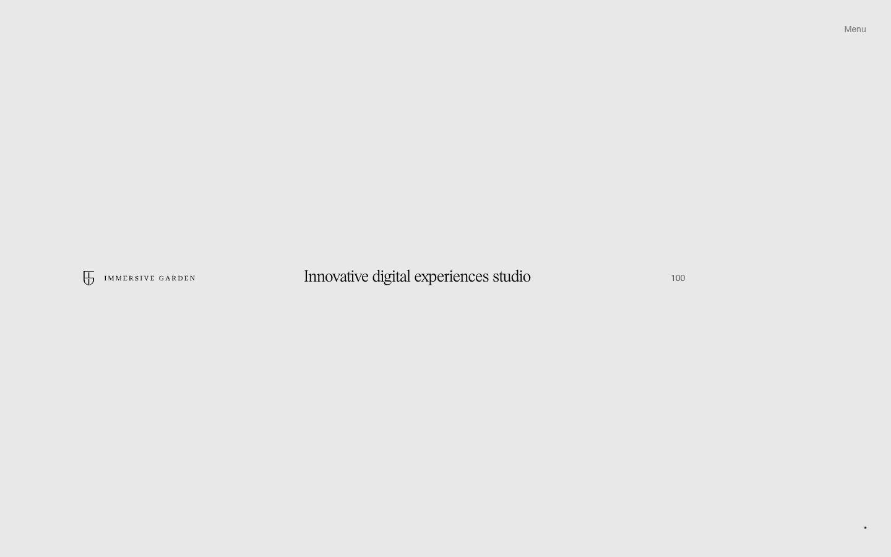
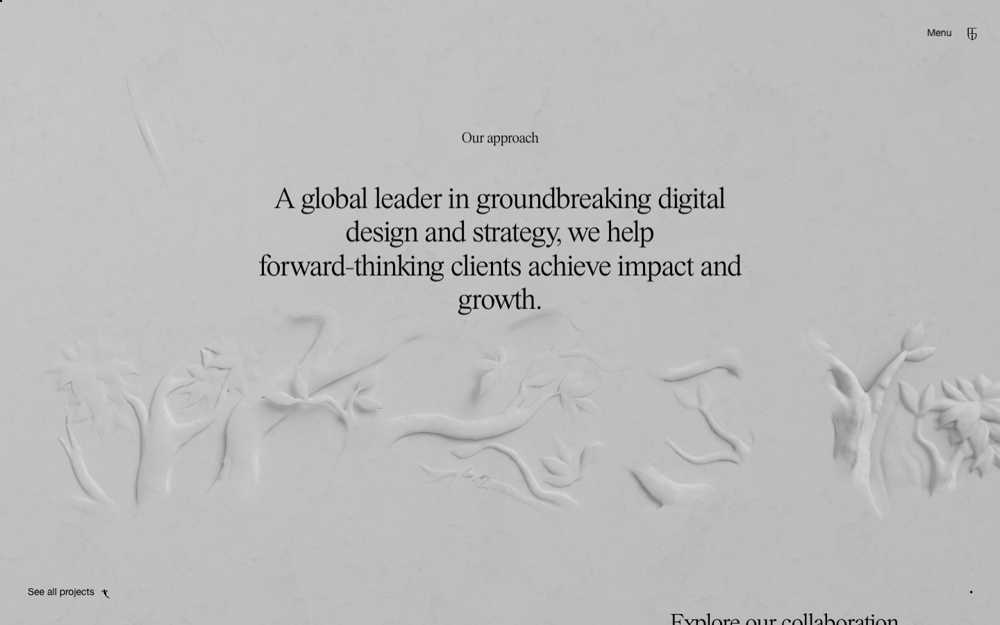

# Immersive Garden website — Awwwards SOTM 2025년 1월 수상작

- **URL**: https://immersive-g.com/
- **수상**: Awwwards Site of the Month, 2025년 1월
- **등록일**: 2026-10-27 (SOTM 2025–2026 일괄 수집)

## 분류 태그 (검색용)

- **스타일**: #미니멀 #실험적 #그레이
- **업종·용도**: #에이전시 #포트폴리오
- **인터랙션**: #제스처내비 #3D탐색 #WebGL
- **어워드 공식 태그**: Web & Interactive, Animation, Experimental, 3D, Gestures / Interaction, UI design, Project Page, Contentful

## 한 줄 요약

> 프랑스 스튜디오 Immersive Garden — 로더 100부터 작품인 실험적 3D 포트폴리오

## 기술 분석 (Claude 작성 — 2026-10-27 실측 정찰 기준)

- 실측 스택: Nuxt · 캔버스 12개 · 스크롤 1화면
- 연회색 여백에 카운터(100)만 두는 미니멀 로더 → 제스처 기반 3D 작품 탐색
- 스크롤 높이 1 — 드래그/제스처가 내비게이션(어워드 태그: Gestures·3D·Experimental), 캔버스 12개
- Nuxt + WebGL, 타이포는 세리프 한 줄로 절제

## 스크린샷

| | |
|---|---|
|  |  |
