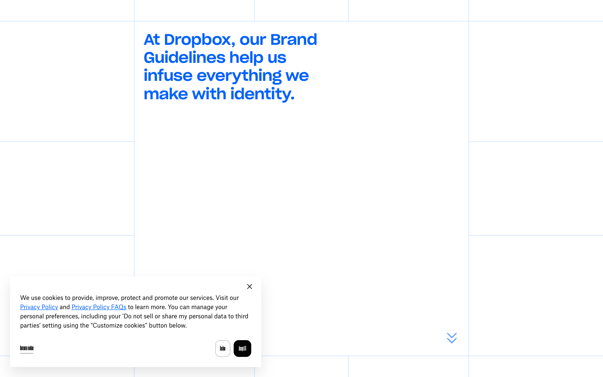
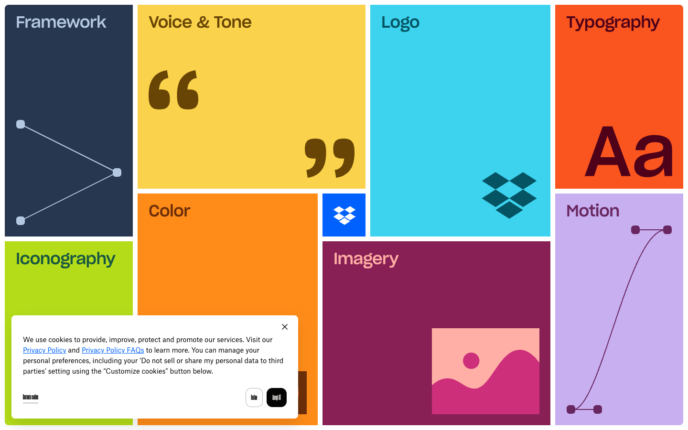

# Dropbox Brand — Awwwards SOTM 2025년 2월 수상작

- **URL**: https://brand.dropbox.com/
- **수상**: Awwwards Site of the Month, 2025년 2월
- **등록일**: 2026-10-27 (SOTM 2025–2026 일괄 수집)

## 분류 태그 (검색용)

- **스타일**: #미니멀 #블루프린트 #그리드
- **업종·용도**: #테크 #브랜드가이드
- **인터랙션**: #모듈러그리드 #그리드내비
- **어워드 공식 태그**: Design Agencies, Animation, Colorful, Navigation Menu, Scrolling, Storytelling, Microinteractions

## 한 줄 요약

> 드롭박스 브랜드 가이드라인 — 블루프린트 모눈 그리드의 모듈러 내비

## 기술 분석 (Claude 작성 — 2026-10-27 실측 정찰 기준)

- 실측 스택: Webflow · 캔버스 0개 · 스크롤 3화면
- 화면 전체가 설계도 모눈이고 콘텐츠 블록이 모듈로 배치되는 그리드 시스템
- 3화면 분량의 가로+세로 혼합 내비게이션(Webflow), 브랜드 각 요소가 셀 단위로 열림
- 기업 브랜드 가이드를 공개 사이트로 만든 대표 사례

## 스크린샷

| | |
|---|---|
|  |  |
