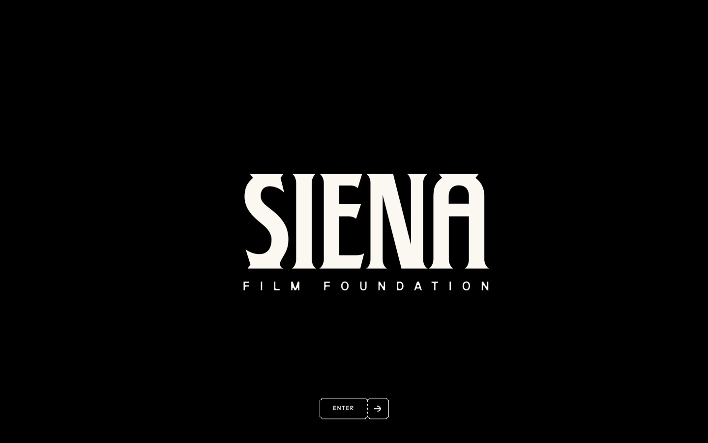

# Siena Film Foundation — Awwwards SOTM 2025년 3월 수상작

- **URL**: https://siena.film/
- **수상**: Awwwards Site of the Month, 2025년 3월
- **등록일**: 2026-10-27 (SOTM 2025–2026 일괄 수집)

## 분류 태그 (검색용)

- **스타일**: #흑백 #시네마 #타이포중심
- **업종·용도**: #문화기관 #영화
- **인터랙션**: #입장게이트 #무한스크롤 #갤러리
- **어워드 공식 태그**: Design Agencies, Film & TV, Institutions, Infinite Scroll, Navigation Menu, Transitions, Filters and Effects, Copy design, Microinteractions

## 한 줄 요약

> ENTER 게이트 → 인피니트 스크롤 필름 아카이브

## 기술 분석 (Claude 작성 — 2026-10-27 실측 정찰 기준)

- 실측 스택: Webflow · 캔버스 1개 · 스크롤 1화면
- 블랙 화면 + 각진 세리프 로고타입 + 티켓 모양 ENTER 버튼의 극장식 입장 연출
- 입장 후 무한 스크롤 갤러리(어워드 태그: Infinite Scroll·Navigation Menu), Webflow 기반
- 필름 포스터 중심의 흑백 시네마 무드
- 유사 메커니즘 데모: [패턴 라이브러리](../interaction-patterns/infinite-gallery.html)

## 스크린샷

| | |
|---|---|
|  |  |
