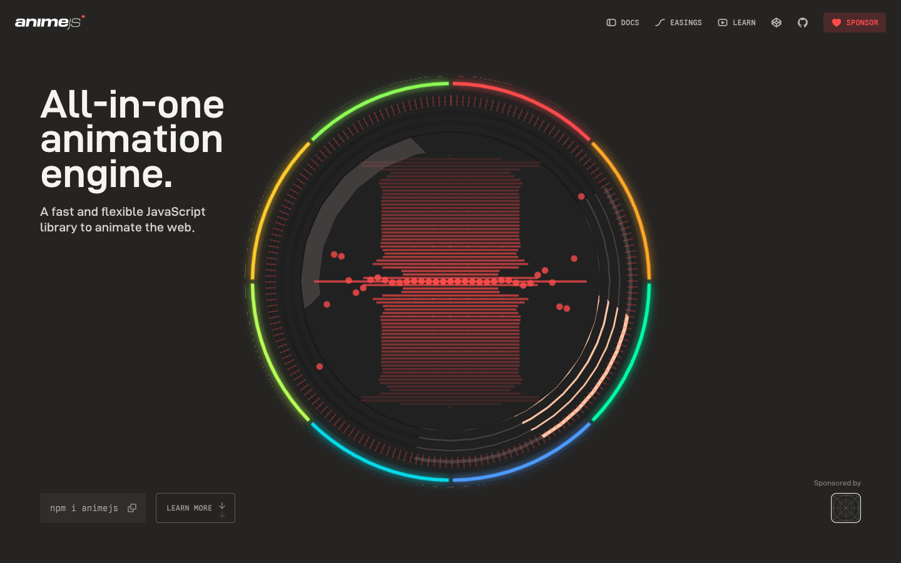
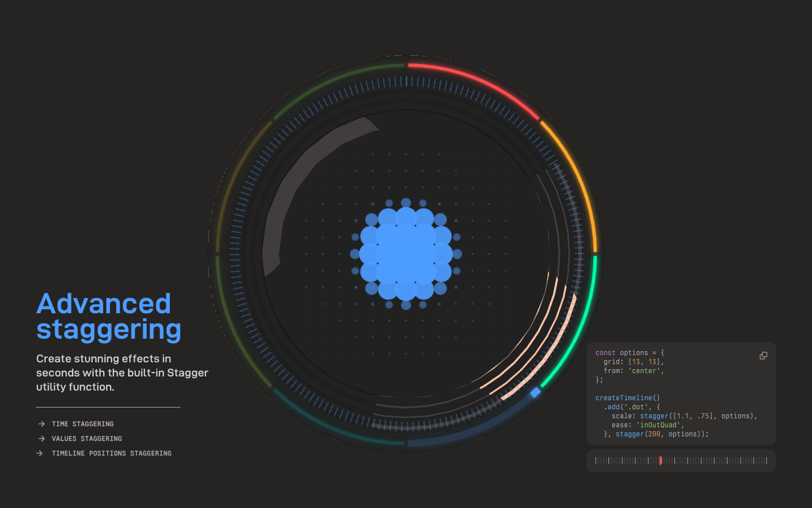

# Anime.js — Awwwards SOTM 2025년 5월 수상작

- **URL**: https://animejs.com/
- **수상**: Awwwards Site of the Month, 2025년 5월
- **등록일**: 2026-10-27 (SOTM 2025–2026 일괄 수집)

## 분류 태그 (검색용)

- **스타일**: #다크 #테크 #데이터비주얼
- **업종·용도**: #개발자도구 #오픈소스
- **인터랙션**: #인터랙티브다이얼 #이징시각화 #스크롤데모
- **어워드 공식 태그**: Technology, Web & Interactive, Animation, Scrolling, 3D

## 한 줄 요약

> Anime.js v4 공식 — 라이브러리 자체가 데모인 인터랙티브 다이얼

## 기술 분석 (Claude 작성 — 2026-10-27 실측 정찰 기준)

- 실측 스택: 캔버스 6개 · 스크롤 23.5화면
- 히어로의 거대한 원형 다이얼이 실시간 이징 곡선/파형을 시각화 — 라이브러리로 라이브러리를 증명
- 23.5화면 문서형 스크롤 + 캔버스 6개의 데모 섹션
- 다크+레인보우 링의 개발자 도구 브랜딩

## 스크린샷

| | |
|---|---|
|  |  |
