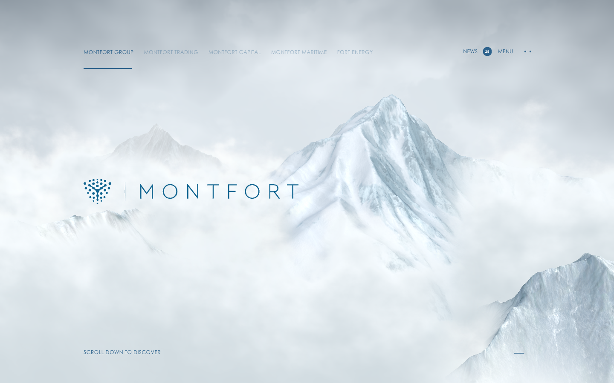
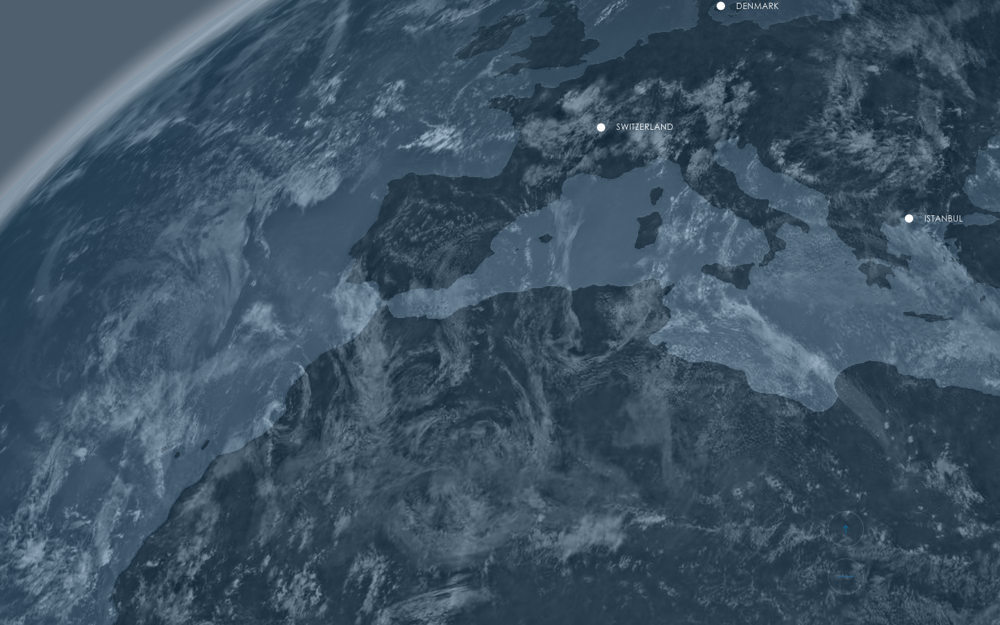

# Montfort — Awwwards SOTM 2025년 6월 수상작

- **URL**: https://mont-fort.com/
- **수상**: Awwwards Site of the Month, 2025년 6월
- **등록일**: 2026-10-27 (SOTM 2025–2026 일괄 수집)

## 분류 태그 (검색용)

- **스타일**: #미니멀 #화이트 #시네마틱
- **업종·용도**: #금융 #그룹사
- **인터랙션**: #3D카메라이동 #스크롤스토리텔링
- **어워드 공식 태그**: Business & Corporate, Web & Interactive, Scrolling, Responsive, 3D, Gestures / Interaction, UI design

## 한 줄 요약

> 설산 구름 파노라마 속을 나아가는 그룹 지주사 사이트

## 기술 분석 (Claude 작성 — 2026-10-27 실측 정찰 기준)

- 실측 스택: 캔버스 2개 · 스크롤 19.6화면
- 실사 설산+구름 합성 파노라마 위 얇은 레터스페이싱 타이포
- 19.6화면 스크롤 — 카메라가 구름을 뚫고 섹션 사이를 이동하는 3D 연출(캔버스 2)
- 5개 계열사를 상단 탭으로 묶은 그룹 IA
- 유사 메커니즘 데모: [패턴 라이브러리](../interaction-patterns/sky-mission.html)

## 스크린샷

| | |
|---|---|
|  |  |
