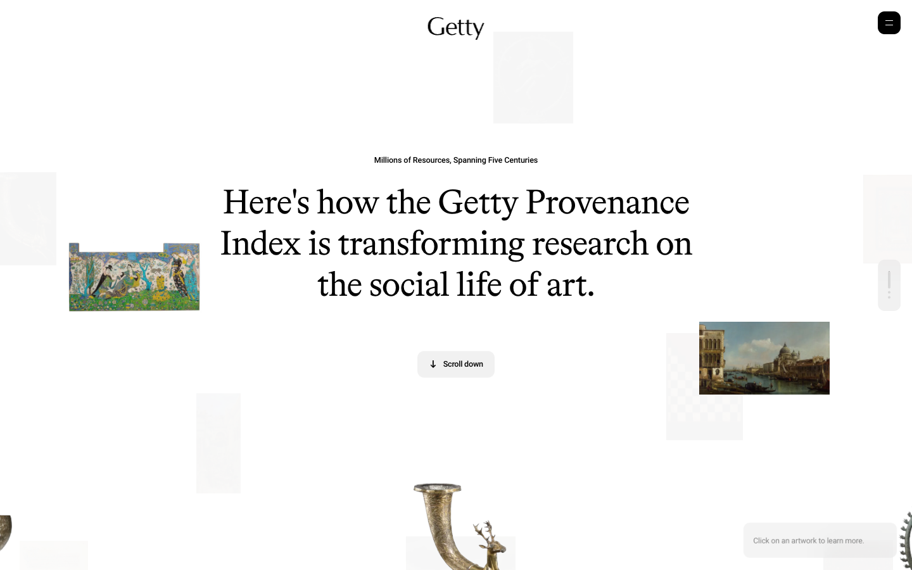
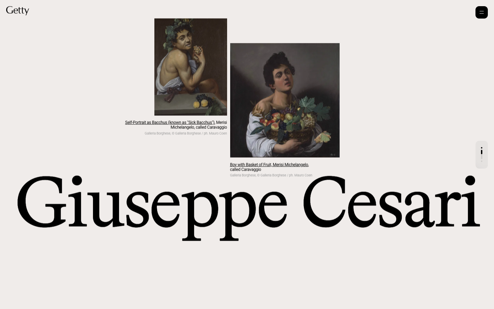

# Tracing Art — Awwwards SOTM 2025년 7월 수상작

- **URL**: https://www.getty.edu/tracingart/
- **수상**: Awwwards Site of the Month, 2025년 7월
- **등록일**: 2026-10-27 (SOTM 2025–2026 일괄 수집)

## 분류 태그 (검색용)

- **스타일**: #에디토리얼 #화이트 #클래식
- **업종·용도**: #문화기관 #아카이브
- **인터랙션**: #롱폼스크롤 #플로팅그리드 #스크롤리빌
- **어워드 공식 태그**: Art & Illustration, Culture & Education, Institutions, Big Background Images, Clean, Colorful, Scrolling, Data Visualization, Content architecture

## 한 줄 요약

> 게티미술관 — 명화 아카이브가 흩어진 90화면짜리 에디토리얼 롱폼

## 기술 분석 (Claude 작성 — 2026-10-27 실측 정찰 기준)

- 실측 스택: Nuxt · 캔버스 1개 · 스크롤 90.5화면
- 명화·유물 이미지가 여백에 흩어진 화이트 에디토리얼, 클릭하면 작품 설명으로
- 90.5화면(!) 분량의 초장축 기사형 스크롤 — Nuxt, 스크롤 리빌 중심
- 기관(Getty) 사이트가 어워드 SOTM을 받은 드문 사례 — 콘텐츠 설계의 힘
- 유사 메커니즘 데모: [패턴 라이브러리](../interaction-patterns/scroll-reveal.html)

## 스크린샷

| | |
|---|---|
|  |  |
