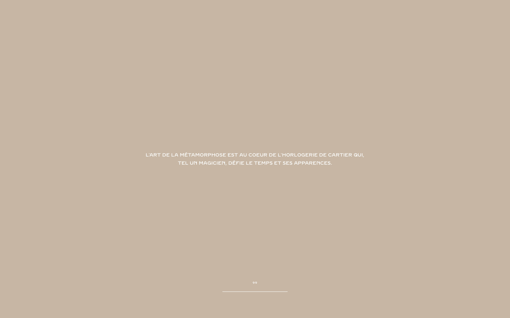

# Cartier Watches & Wonders 2025 — Awwwards SOTM 2025년 8월 수상작

- **URL**: https://cartier-waw-0225.dev.60fps.fr/
- **수상**: Awwwards Site of the Month, 2025년 8월
- **등록일**: 2026-10-27 (SOTM 2025–2026 일괄 수집)

## 분류 태그 (검색용)

- **스타일**: #럭셔리 #베이지 #절제
- **업종·용도**: #패션 #주얼리시계
- **인터랙션**: #휠하이재킹 #챕터스토리텔링 #WebGL
- **어워드 공식 태그**: Web & Interactive, Animation, Responsive Design, Scrolling, WebGL, Experimental, 3D, Gestures / Interaction, UI design, Motion, Luxury

## 한 줄 요약

> 까르띠에 워치스앤원더스 — 불어 카피로 여는 시계 매직 스토리텔링

## 기술 분석 (Claude 작성 — 2026-10-27 실측 정찰 기준)

- 실측 스택: 캔버스 0개 · 스크롤 1화면
- 베이지 단색 화면에 카피 한 줄로 시작하는 절제된 인트로(60fps.fr 제작 dev 도메인)
- 스크롤 높이 0의 휠 하이재킹 구조 — 헤드리스 캡처에는 본편 미디어가 잡히지 않음(lazy 로드)
- 어워드 태그: WebGL·Scrolling — 시계 제품을 변신(métamorphose) 테마로 연결하는 챕터 연출로 추정

## 스크린샷

| | |
|---|---|
|  |  |
