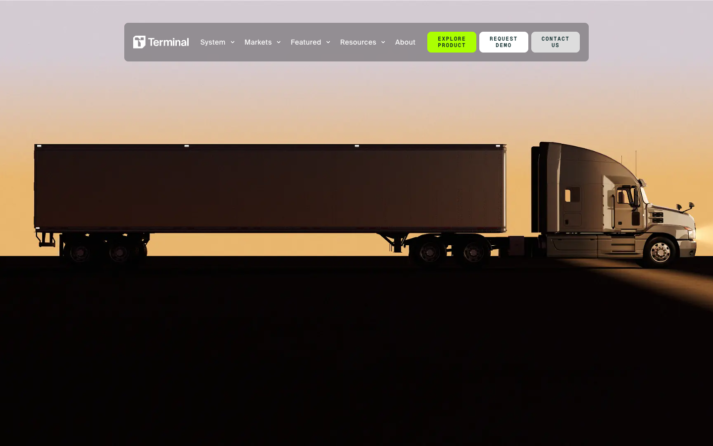
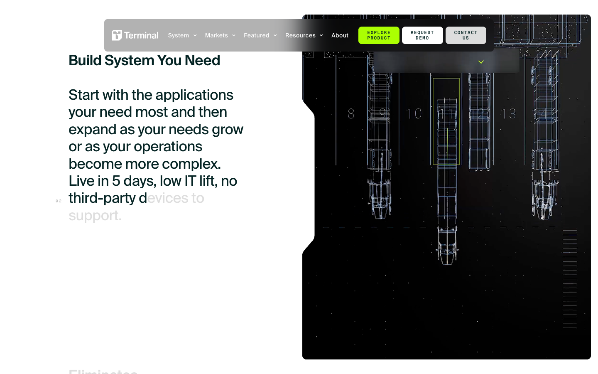

# Terminal Industries — Awwwards SOTM 2025년 9월 수상작

- **URL**: https://terminal-industries.com/
- **수상**: Awwwards Site of the Month, 2025년 9월
- **등록일**: 2026-10-27 (SOTM 2025–2026 일괄 수집)

## 분류 태그 (검색용)

- **스타일**: #시네마틱 #다크 #테크
- **업종·용도**: #물류 #B2B #AI
- **인터랙션**: #스크롤스토리텔링 #실사히어로
- **어워드 공식 태그**: Business & Corporate, Technology, Animation, CSS, Scrolling, Storytelling, Interaction Design, Vue.js, Startups, Vercel

## 한 줄 요약

> 야드 물류 AI — 황혼 트럭 실사의 시네마틱 B2B 스크롤리텔링

## 기술 분석 (Claude 작성 — 2026-10-27 실측 정찰 기준)

- 실측 스택: Nuxt · 캔버스 1개 · 스크롤 17.5화면
- 황혼 역광의 트레일러 실사 히어로 — 영화 포스터 같은 조도 연출
- 17.5화면 분량을 CSS 중심(어워드 태그: CSS·Scrolling)으로 처리한 Nuxt 사이트
- 녹색 형광 CTA 포인트 + 모노스페이스 레이블의 테크 B2B 문법

## 스크린샷

| | |
|---|---|
|  |  |
