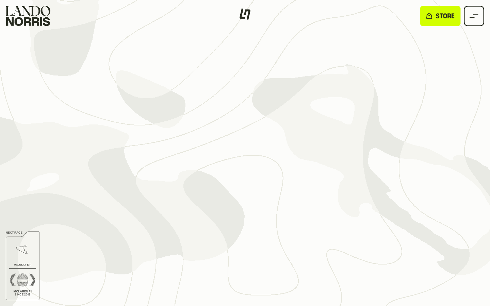

# Lando Norris — Awwwards SOTM 2025년 11월 수상작

- **URL**: https://landonorris.com/
- **수상**: Awwwards Site of the Month, 2025년 11월
- **등록일**: 2026-10-27 (SOTM 2025–2026 일괄 수집)

## 분류 태그 (검색용)

- **스타일**: #스포츠 #크림 #형광포인트
- **업종·용도**: #스포츠 #퍼스널브랜드
- **인터랙션**: #데이터위젯 #캔버스그래픽 #스크롤리빌
- **어워드 공식 태그**: Promotional, Sports, Web & Interactive, Colorful, WebGL, GSAP, 3D, Gestures / Interaction, Webflow

## 한 줄 요약

> F1 랜도 노리스 공식 — 서킷 등고선 패턴 위 레이싱 데이터 비주얼

## 기술 분석 (Claude 작성 — 2026-10-27 실측 정찰 기준)

- 실측 스택: Webflow · 캔버스 21개 · 스크롤 15.1화면
- 크림 배경에 서킷/등고선 그래픽 패턴, NEXT RACE 위젯(멕시코 GP) 등 데이터 연동
- 15화면 분량 + 캔버스 21개 — 구간마다 WebGL/캔버스 그래픽을 깐 하이브리드
- 형광 옐로 포인트의 스포츠 브랜딩 + 스토어 연결

## 스크린샷

| | |
|---|---|
|  |  |
