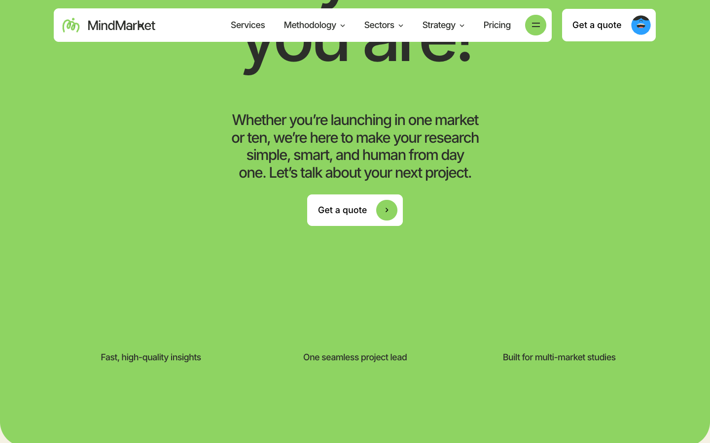

# MindMarket — Awwwards SOTM 2025년 12월 수상작

- **URL**: https://mindmarket.com/
- **수상**: Awwwards Site of the Month, 2025년 12월
- **등록일**: 2026-10-27 (SOTM 2025–2026 일괄 수집)

## 분류 태그 (검색용)

- **스타일**: #컬러풀 #일러스트중심 #플랫
- **업종·용도**: #B2B #리서치
- **인터랙션**: #캐릭터애니메이션 #스크롤리빌
- **어워드 공식 태그**: Art & Illustration, Culture & Education, Promotional, Animation, Colorful, Flat Design, Scrolling, Illustration, Storytelling, GSAP, Figma, DatoCMS

## 한 줄 요약

> 그린 단색 배경 + 플랫 일러스트 캐릭터가 뛰노는 리서치 회사 사이트

## 기술 분석 (Claude 작성 — 2026-10-27 실측 정찰 기준)

- 실측 스택: 캔버스 14개 · 스크롤 15.3화면
- 비비드 그린 위 흑색 대형 타이포 + 컬러풀 캐릭터 일러스트의 대비
- 15화면 분량, 캔버스 14개 — 섹션별 캐릭터 애니메이션(로티 또는 캔버스 스프라이트)로 추정
- 어워드 태그: Colorful·Animation — 일러스트 주도형 B2B 브랜딩의 모범

## 스크린샷

| | |
|---|---|
|  |  |
