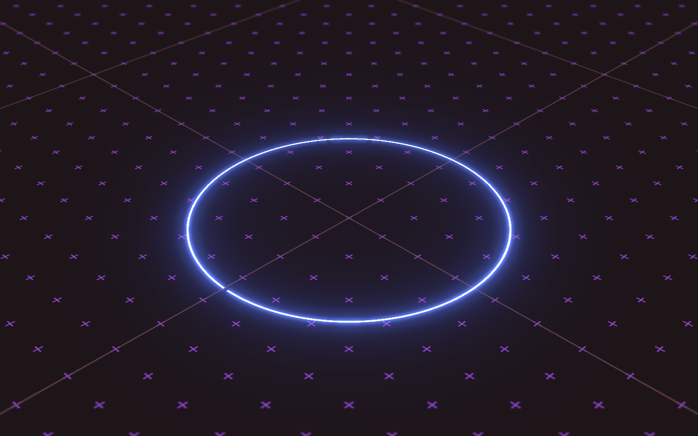
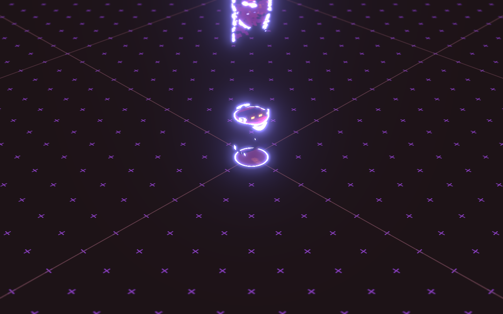

# Bruno's Portfolio — Awwwards SOTM 2026년 1월 수상작

- **URL**: https://bruno-simon.com/
- **수상**: Awwwards Site of the Month, 2026년 1월
- **등록일**: 2026-10-27 (SOTM 2025–2026 일괄 수집)

## 분류 태그 (검색용)

- **스타일**: #네온 #게임 #다크
- **업종·용도**: #포트폴리오 #개인
- **인터랙션**: #3D월드탐험 #게임형내비 #WebGL
- **어워드 공식 태그**: Games & Entertainment, Web & Interactive, WebGL, GSAP, Three.js, 3D

## 한 줄 요약

> 브루노 시몽의 새 포트폴리오 — 네온 그리드 3D 월드를 돌아다니는 게임형

## 기술 분석 (Claude 작성 — 2026-10-27 실측 정찰 기준)

- 실측 스택: 캔버스 1개 · 스크롤 1화면
- 로딩 링 → 네온 와이어프레임 바닥 그리드의 3D 월드로 진입(단일 WebGL 캔버스, 스크롤 0)
- 글로잉 오브젝트가 떠 있는 아케이드 무드 — 전작(자동차 운전 포트폴리오)의 계보를 잇는 탐험형 내비게이션
- Three.js 작가 본인의 사이트답게 R3F/Three 스택(어워드 태그: Three.js·GSAP)

## 스크린샷

| | |
|---|---|
|  |  |
