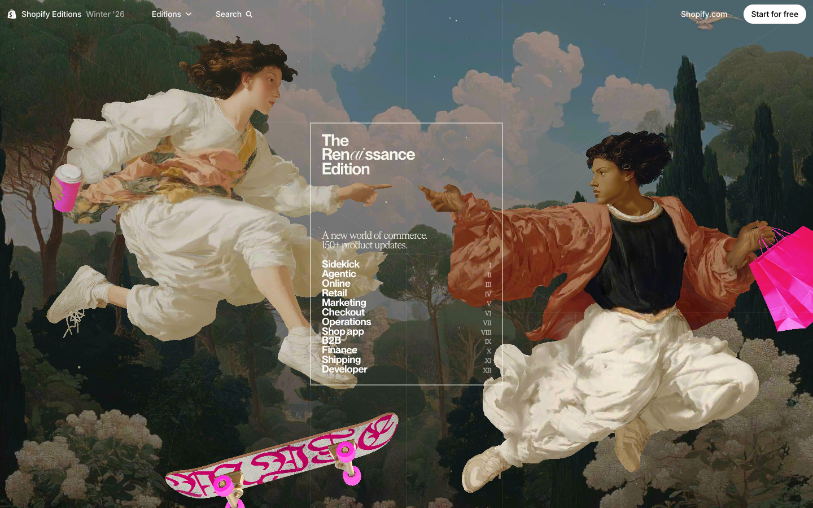
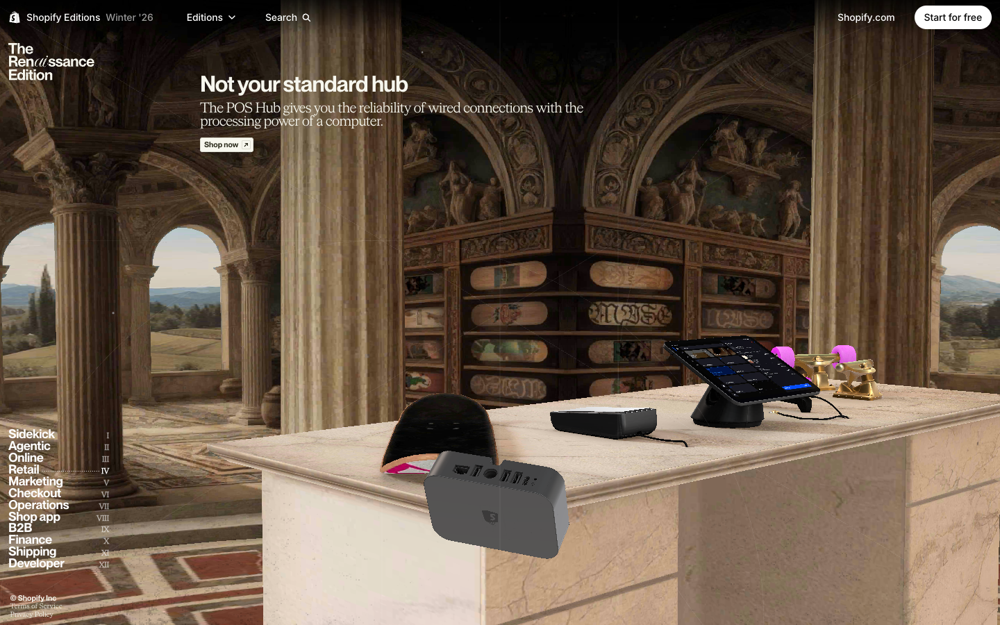

# The Renaissance Edition — Awwwards SOTM 2026년 2월 수상작

- **URL**: https://www.shopify.com/editions/winter2026
- **수상**: Awwwards Site of the Month, 2026년 2월
- **등록일**: 2026-10-27 (SOTM 2025–2026 일괄 수집)

## 분류 태그 (검색용)

- **스타일**: #맥시멀 #아트콜라주 #형광포인트
- **업종·용도**: #테크 #커머스
- **인터랙션**: #스크롤스토리텔링 #챕터내비 #콜라주애니메이션
- **어워드 공식 태그**: E-Commerce, Technology, Web & Interactive, Animation, Parallax, WebGL, Transitions, Shopify, 3D, Gestures / Interaction, Interaction Design, Blender

## 한 줄 요약

> 쇼피파이 Winter '26 — 르네상스 명화 콜라주가 커머스 업데이트를 소개

## 기술 분석 (Claude 작성 — 2026-10-27 실측 정찰 기준)

- 실측 스택: 캔버스 2개 · 스크롤 60.1화면
- 명화 인물들이 스케이트보드·쇼핑백 같은 형광 소품과 콜라주된 아트디렉션
- 60화면 분량 스크롤 — 12개 챕터(로마숫자 목차)로 제품 업데이트 150+개를 내비게이션
- 히어로의 "Ren(ai)ssance" 워드마크처럼 AI 테마를 고전 미술로 비튼 컨셉

## 스크린샷

| | |
|---|---|
|  |  |
