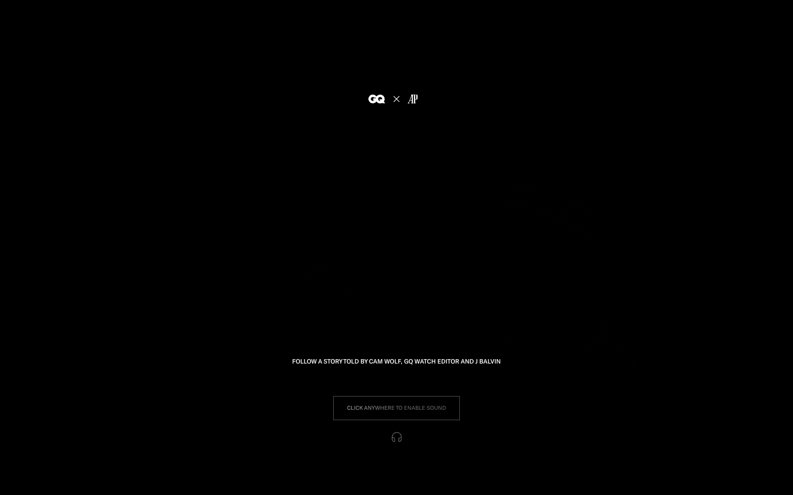
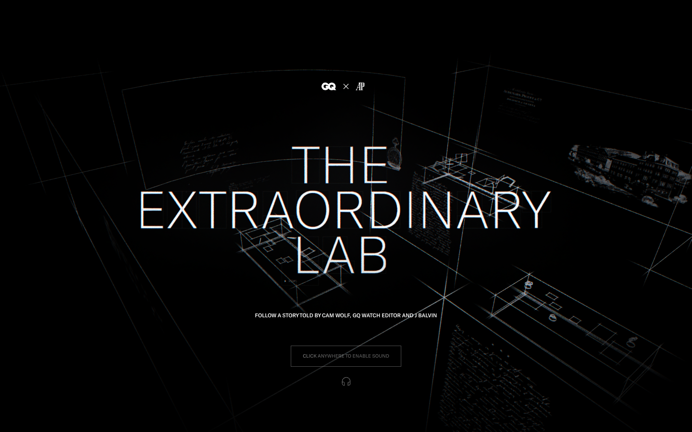

# GQ & AP The Extraordinary Lab — Awwwards SOTM 2026년 3월 수상작

- **URL**: https://www.gq.com/sponsored/story/the-extraordinary-lab
- **수상**: Awwwards Site of the Month, 2026년 3월
- **등록일**: 2026-10-27 (SOTM 2025–2026 일괄 수집)

## 분류 태그 (검색용)

- **스타일**: #다크 #럭셔리 #에디토리얼
- **업종·용도**: #패션 #미디어
- **인터랙션**: #사운드게이트 #휠하이재킹 #챕터스토리텔링
- **어워드 공식 태그**: Fashion, Web & Interactive, Responsive Design, WebGL, Experimental, 3D, Gestures / Interaction, Nuxt.js, Blender

## 한 줄 요약

> GQ×오데마피게 — 사운드 필수의 다크 스토리텔링 (J발빈 내레이션)

## 기술 분석 (Claude 작성 — 2026-10-27 실측 정찰 기준)

- 실측 스택: Nuxt · 캔버스 1개 · 스크롤 1화면
- "CLICK ANYWHERE TO ENABLE SOUND" 게이트로 시작하는 오디오 주도형 경험
- Nuxt+단일 캔버스, 스크롤 높이 0 — 휠이 씬 타임라인을 넘기는 챕터 구조
- 에디토리얼(콩데나스트 스폰서드)과 럭셔리 시계 브랜드의 콜라보 캠페인

## 스크린샷

| | |
|---|---|
|  |  |
