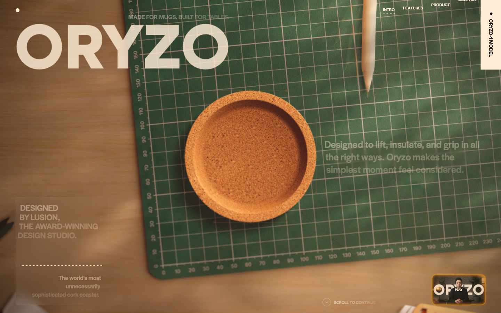
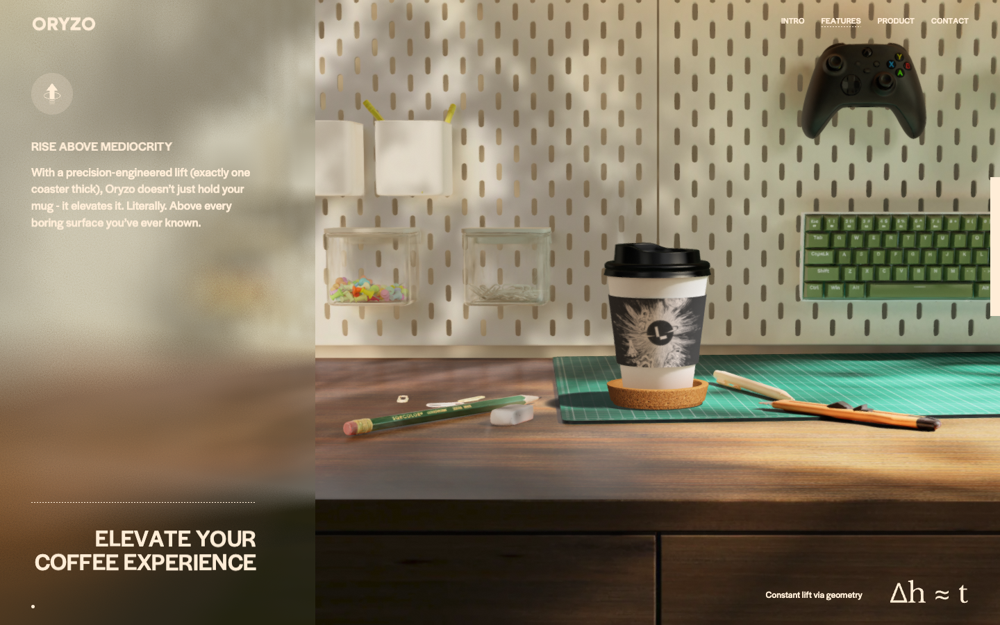

# Oryzo AI — Awwwards SOTM 2026년 4월 수상작

- **URL**: https://oryzo.ai/
- **수상**: Awwwards Site of the Month, 2026년 4월
- **등록일**: 2026-10-27 (SOTM 2025–2026 일괄 수집)

## 분류 태그 (검색용)

- **스타일**: #시네마틱 #유머 #레트로
- **업종·용도**: #제품브랜드 #실험
- **인터랙션**: #영상스크럽 #스크롤스토리텔링 #WebGL전환
- **어워드 공식 태그**: Art & Illustration, Design Agencies, Web & Interactive, WebGL, Transitions, Storytelling, GSAP, Three.js, 3D, Filters and Effects

## 한 줄 요약

> Lusion이 만든 "세상에서 가장 과하게 정교한 코르크 컵받침" 패러디 제품 런칭

## 기술 분석 (Claude 작성 — 2026-10-27 실측 정찰 기준)

- 실측 스택: 캔버스 6개 · 스크롤 63화면
- 실사 탑뷰 영상(커팅매트 위 코르크 코스터) 위에 타이포를 얹는 영상 합성 히어로
- 63화면 분량의 초장축 스크롤리텔링 + 캔버스 6개 — 영상 스크럽과 WebGL 전환의 혼합
- AI 제품 광고 문법을 그대로 가져온 유머 카피("Made for mugs. Built for tables.")가 수상 포인트
- 유사 메커니즘 데모: [패턴 라이브러리](../interaction-patterns/sky-mission.html)

## 스크린샷

| | |
|---|---|
|  |  |
