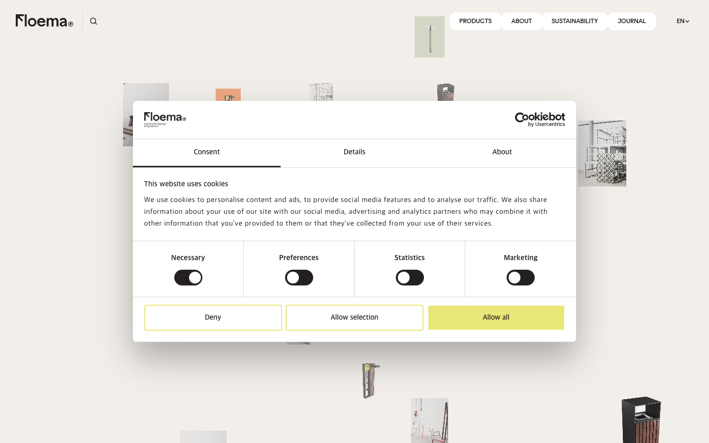
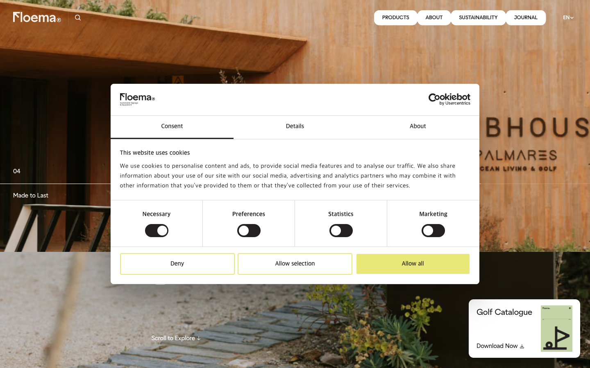

# Floema — Awwwards SOTM 2026년 5월 수상작

- **URL**: https://www.floema.com/en
- **수상**: Awwwards Site of the Month, 2026년 5월
- **등록일**: 2026-10-27 (SOTM 2025–2026 일괄 수집)

## 분류 태그 (검색용)

- **스타일**: #미니멀 #화이트 #에디토리얼
- **업종·용도**: #제품브랜드 #B2B
- **인터랙션**: #플로팅그리드 #패럴랙스
- **어워드 공식 태그**: Business & Corporate, E-Commerce, Promotional, Photographic, WebGL, Storytelling, GSAP, 3D, Header Design, Nuxt.js

## 한 줄 요약

> 지속가능 사이니지 제품 브랜드 — 제품이 공중에 흩어진 매거진형 그리드

## 기술 분석 (Claude 작성 — 2026-10-27 실측 정찰 기준)

- 실측 스택: 캔버스 3개 · 스크롤 16화면
- 히어로에 제품 사진들이 여백을 두고 흩어진 플로팅 그리드(스크롤 패럴랙스)
- 16화면 분량, 캔버스 3개 — 구간 전환용 WebGL 이미지 효과로 추정
- 실측 중 Cookiebot 모달이 캡처를 가림 — 본편 무드는 화이트+옐로 포인트의 카탈로그형

## 스크린샷

| | |
|---|---|
|  |  |
