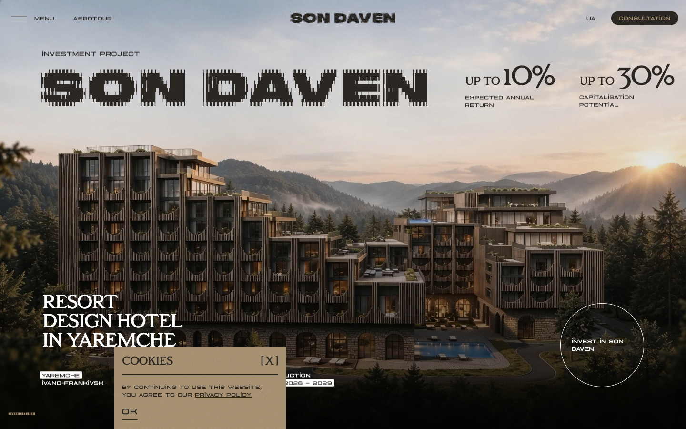
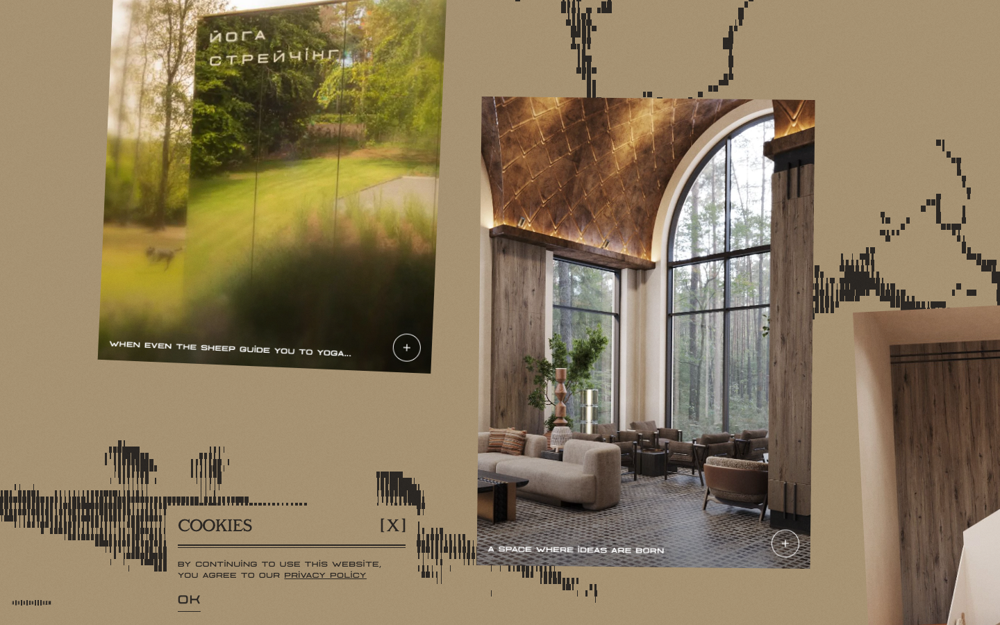

# Son Daven — Awwwards SOTM 2026년 6월 수상작

- **URL**: https://sondaven.com/en
- **수상**: Awwwards Site of the Month, 2026년 6월
- **등록일**: 2026-10-27 (SOTM 2025–2026 일괄 수집)

## 분류 태그 (검색용)

- **스타일**: #시네마틱 #자연 #세리프
- **업종·용도**: #부동산 #호텔리조트
- **인터랙션**: #이미지시퀀스 #스크롤스토리텔링 #디스플레이타이포
- **어워드 공식 태그**: E-Commerce, Food & Drink, Hotel / Restaurant, Animation, Scrolling, WebGL, Storytelling, GSAP, UI design, Microinteractions, Webflow

## 한 줄 요약

> 도트 디스플레이 타이포가 글리치로 조립되는 산악 리조트 투자 사이트

## 기술 분석 (Claude 작성 — 2026-10-27 실측 정찰 기준)

- 실측 스택: GSAP 3.13.0 · Lenis · Webflow · 캔버스 16개 · 스크롤 36.9화면
- LED 전광판풍 디스플레이 타이포 히어로 — 글자가 도트 글리치로 조립됨
- 37화면 분량 스크롤 + 캔버스 16개(구간별 이미지 시퀀스 스크럽으로 추정), GSAP 3.13+Lenis 실측
- 실사 건축 렌더 + 세리프/디스플레이 타이포 혼용, 우상단 원형 인장 배지
- 유사 메커니즘 데모: [패턴 라이브러리](../interaction-patterns/image-sequence.html)

## 스크린샷

| | |
|---|---|
|  |  |
