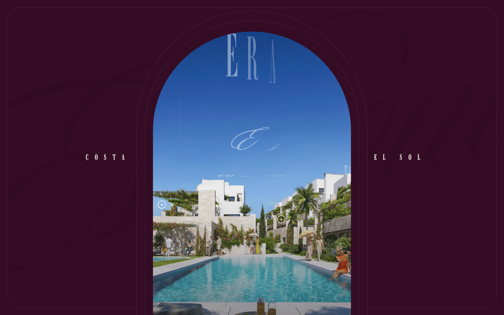
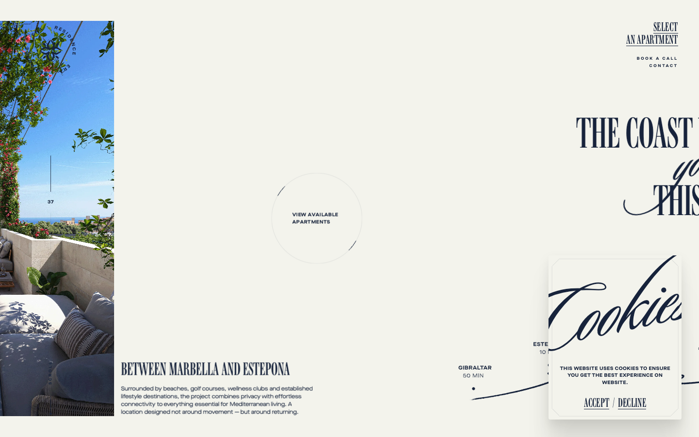

# ERA Residence — Awwwards SOTM 2026년 8월 수상작

- **URL**: https://www.era-residence.com/
- **수상**: Awwwards Site of the Month, 2026년 8월
- **등록일**: 2026-10-27 (SOTM 2025–2026 일괄 수집)

## 분류 태그 (검색용)

- **스타일**: #럭셔리 #세리프 #버건디
- **업종·용도**: #부동산 #브랜드
- **인터랙션**: #패럴랙스 #스크롤스토리텔링 #마스크프레임
- **어워드 공식 태그**: Architecture, Parallax, Storytelling, GSAP, Real Estate, Photo & Video, Webflow, Luxury

## 한 줄 요약

> 아치 프레임 속으로 빨려 들어가는 럭셔리 부동산 스토리텔링

## 기술 분석 (Claude 작성 — 2026-10-27 실측 정찰 기준)

- 실측 스택: GSAP 3.15.0 · Lenis · Webflow · 캔버스 0개 · 스크롤 27.3화면
- 보라 배경의 아치(창) 프레임 안에 리조트 키 비주얼 — 스크롤하면 프레임 속으로 진입하는 구조
- 27화면 분량 GSAP+Lenis 패럴랙스 스토리텔링 (Webflow 기반, 실측 GSAP 3.15)
- 세리프 레터스페이싱 타이포 + BY DAY/BY NIGHT 토글
- 유사 메커니즘 데모: [패턴 라이브러리](../interaction-patterns/clip-expand.html)

## 스크린샷

| | |
|---|---|
|  |  |
