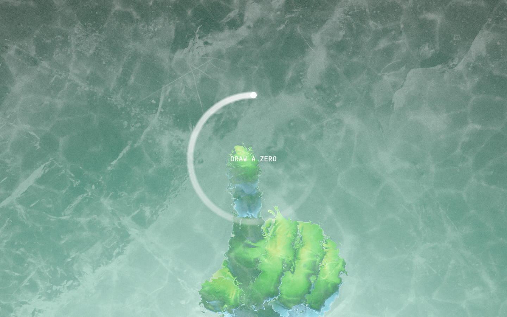
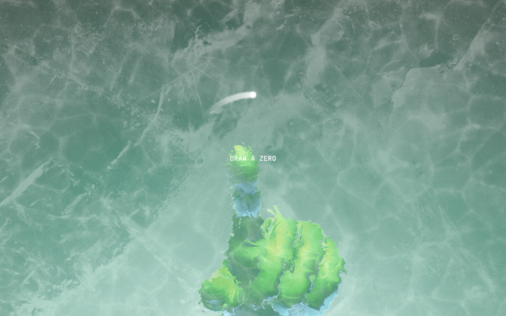

# Why Zero — Awwwards SOTM 2026년 9월 수상작

- **URL**: https://why.zero.university/
- **수상**: Awwwards Site of the Month, 2026년 9월
- **등록일**: 2026-10-27 (SOTM 2025–2026 일괄 수집)

## 분류 태그 (검색용)

- **스타일**: #실험적 #몰입형 #그린
- **업종·용도**: #교육 #캠페인
- **인터랙션**: #제스처게이트 #휠하이재킹 #WebGL #사운드
- **어워드 공식 태그**: Culture & Education, Technology, Single page, Sound-Audio, Storytelling, GSAP, Three.js, 3D, Gestures / Interaction, Filters and Effects, Startups, Blender

## 한 줄 요약

> 제스처로 0을 그려야 입장하는 사운드 스토리텔링 — Zero University 캠페인

## 기술 분석 (Claude 작성 — 2026-10-27 실측 정찰 기준)

- 실측 스택: 캔버스 1개 · 스크롤 1화면
- 인트로에서 마우스로 원(0)을 그리는 제스처 게이트 — 커서 궤적이 빛 리본으로 남음
- 수면 위 섬 비주얼의 풀스크린 WebGL 단일 캔버스, 휠 하이재킹(스크롤 높이 0)
- Three.js+GSAP+사운드 오디오 연출(어워드 태그 기준)

## 스크린샷

| | |
|---|---|
|  |  |
